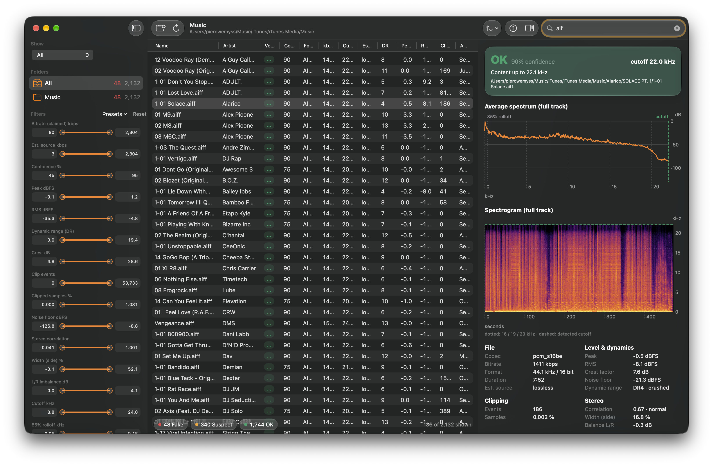
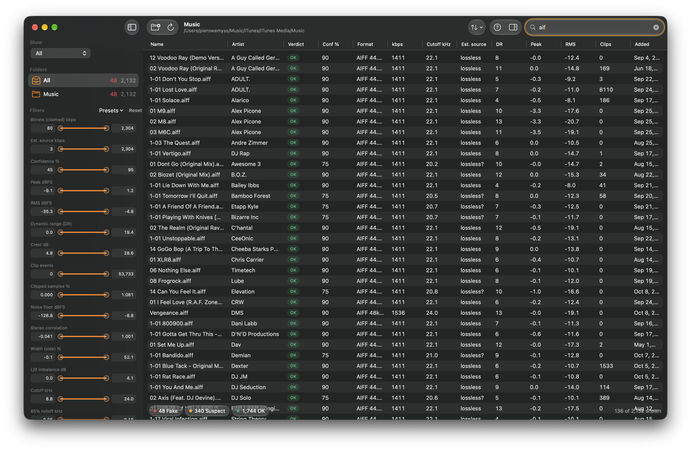

<p align="center">
  
</p>

<h1 align="center">SonoSeal</h1>

<p align="center">
  Catch fake-lossless audio in your music library.<br>
  A native macOS app that flags transcodes and measures level, dynamic range, clipping, stereo image and bandwidth.
</p>

<p align="center">
  
  
</p>



## Features

- **Fake-lossless detection.** Finds the spectral cutoff of every track and estimates the real source bitrate, so a 128 kbps MP3 saved as AIFF or FLAC gets marked **Fake** or **Suspect** with a confidence score.
- **Full-track spectrum and spectrogram** in the inspector, with the detected cutoff and the 16/19/20 kHz guides drawn on top.
- **Level and dynamics:** peak, RMS, crest factor, noise floor and DR value.
- **Clipping:** clip events and the percentage of clipped samples.
- **Stereo:** correlation, side width and L/R balance.
- **Filter and sort** the whole library with range sliders and presets, plus search and folder scoping.
- **Cached results**, so a rescan only analyzes new or changed files.



## Build

Requires macOS 26 and Xcode 26 (or the matching Swift toolchain).

```sh
git clone <this repo>
cd SonoSeal/swift
./make-app.sh
open SonoSeal.app
```

`make-app.sh` builds a release binary and wraps it in an ad-hoc signed `SonoSeal.app` inside `swift/`. Drag it to `/Applications` if you want to keep it.

If the build fails after you move or rename the folder, delete the stale cache with `rm -rf .build` and run the script again.

## Tests

```sh
cd swift
swift test -c release
```

The tests use real tracks in `samples/`, with known transcodes in `samples/Fakes/`. The folder is gitignored because the audio is copyrighted, so add your own files there. Without it, the sample checks are skipped.
